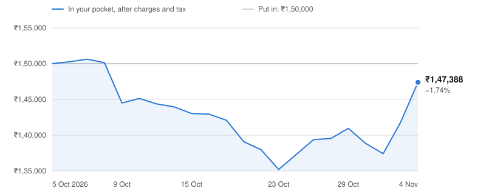

# nsebot — NSE paper trading on free data

<!-- progress:start — drawn by scripts/progress.py after every bot run; edits here are overwritten -->
## How the money is doing

**₹1,45,560 in your pocket**, from ₹1,50,000 put in on 5 Oct 2026 (−2.96%), at the close on 13 Nov 2026.

<picture>
  <source media="(prefers-color-scheme: dark)" srcset="docs/progress/chart-dark.svg">
  
</picture>

That is what the three bots' paper trades would have left you with as real trades, had you sold everything at that close: after Zerodha's charges and slippage on every trade, the cost of selling the open positions, and income tax on the profit.

| Bot | Since | Value | Return | Change on 13 Nov | Closed trades | Open now |
|---|---|---|---|---|---|---|
| Momentum | 5 Oct 2026 | ₹1,46,306 | −4.71% | −₹1,102 | 3 | 10 |
| Swing (retired) | 5 Oct 2026 | ₹0 | +3.36% | ₹0 | 4 | 0 |
| Intraday (retired) | 9 Oct 2026 | ₹0 | −11.84% | ₹0 | 75 | 0 |
| **All three** | | **₹1,46,306** | **−2.46%** | −₹1,102 | 82 | 10 |
| Selling the open positions | | −₹358 | | | | |
| Tax on the profit | | −₹389 | | | | |
| **In your pocket** | | **₹1,45,560** | **−2.96%** | | | |

<sub>Value is cash plus open positions at the close, after the charges already paid. A bot's return is time-weighted, so money moved between bots counts as neither profit nor loss; a retired bot's cash moves to momentum once it is flat (state/sleeves.json). Tax is 20.8% on delivery profits (short-term capital gains) and 31.2% on intraday profits (speculative income at the top slab); a loss pays none. Dividends and tax-year boundaries are not modelled. Updated by each bot after its run.</sub>
<!-- progress:end -->

A lean NSE trading engine with three modes that share one risk core. **Since 3 Nov 2026 the whole book runs one of them, momentum**; the other two are retired ([`state/sleeves.json`](state/sleeves.json)) and hand their cash to it once flat.

| Mode | Status | Product | Data | When it runs | Strategy |
|---|---|---|---|---|---|
| **momentum** | **active: the whole book** | CNC (delivery), paper only | NSE's equity list + Yahoo daily bars (free) | 17:40 IST on weekdays, GitHub Actions | The 10 strongest of every NSE-listed stock by 12-1 momentum, re-ranked every 5 sessions |
| **swing** | retired 3 Nov 2026 | CNC (delivery) | Yahoo daily bars (free) | only while it still holds something | Dip reversion inside long-term uptrends |
| **intraday** | retired 3 Nov 2026 | MIS (5x margin) | Yahoo 5-minute bars (free) | never (flat) | Opening-range breakout with VWAP and volume confirmation, long and short |

Execution is **paper by default**. A Zerodha Kite Connect adapter switches on when API credentials are configured (see [Kite](#zerodha-kite)).

This is V3, a rebuild after V2 stopped trading on 14 Sep 2026. The full story is in:
- [`docs/AUTOPSY_V2.md`](docs/AUTOPSY_V2.md): why V2 froze;
- [`docs/RESEARCH.md`](docs/RESEARCH.md): what the data supports;
- [`docs/DIAGNOSIS.md`](docs/DIAGNOSIS.md): why the first live weeks lost money, and what changed.

The V1/V2 code lives in [`legacy/`](legacy/).

---

## Honest status

All numbers below come from the bot's own code run on real NSE data, net of Zerodha costs.

**Why one strategy.**
- The owner chose growth over hit rate and smooth returns (Nov 2026).
- Momentum is the only design here with an out-of-sample record.
- Intraday had no edge: 55 live trades lost 0.30R each after costs, and no research variant was ever net-positive.
- Swing's full-engine backtest makes +2.9% a year, less than its idle cash would earn in a liquid fund.

**Momentum is the whole book now.**
- **Size and filter re-tested, nothing changed.** Round 10 ([`docs/RESEARCH.md`](docs/RESEARCH.md)) re-tested the design for a 3–5 year horizon on ₹1.5L: top 5, 7, 10 or 15, with and without a filter against stocks that just jumped. Its pre-registered rule kept the deployed design, **top 10, 12-1 momentum, every 5 sessions**.
  - Holding 5 or 7 names fell 59–68% at worst.
  - The filter's lead came almost entirely from the years it was found in.
- **What ₹1,50,000 became in the backtest,** every start date since Jul 2018 (310 three-year and 190 five-year windows):

  | After | Worst | 10th percentile | Median | 90th percentile |
  |---|---|---|---|---|
  | 3 years | ₹2.24 L | ₹3.13 L | ₹4.17 L | ₹5.07 L |
  | 5 years | ₹3.07 L | ₹4.46 L | ₹7.88 L | ₹13.0 L |

  **Read that as an upper bound, not a forecast:**
  - stocks delisted before today are missing, which flatters every momentum figure;
  - 2018–26 contained one of the largest smallcap booms on record;
  - the windows overlap, so there are fewer than three independent 3-year periods;
  - short-term capital gains tax isn't charged.
- **Risk.** The worst drawdown on the way was **−53%**.
  - Half of all sessions were spent 20%+ below the previous high.
  - 28% of 12-month windows lost money.
  - 53% of trades made money; the best tenth of trades made all of the profit.
- **Against funds.** Untouched Jul 2018 – Jul 2023: +22.6% to +32.6% CAGR across rebalance timings, against +21.7% for the median active smallcap fund and +28.7% for the best. Jul 2018 – Oct 2026: +30.2% to +37.7%, against +18.5% and +24.5% (rounds 5–8).
- **Engine fidelity.** The live engine, replayed on real data, matches the research within a few tenths of a point on the same rebalance days.
- **Live so far.** From 5 Oct to 28 Oct 2026 it made −4.6% once the BHAGYANGR demerger is counted properly, against −5.1% for an equal-weight hold of every eligible NSE stock. The ledger had booked that demerger as an 89% loss; it is now credited (see [corporate actions](#sleeves-and-corporate-actions)).

**Retired.**
- **Swing.** S4b dip reversion passed out-of-sample on 2023–26 (+0.69% a trade), then failed on untouched 2018–20 data and froze in the COVID crash.
- **Intraday.** Live data collection showed what the research did: costs of 0.19R a trade against a gross edge of about zero.
- **The V2 breakout signal** lost money in both halves of the history and was removed.

The engine history behind swing's design (Kelly sizing collapse, breaker deadlock, the regime dial) is in [`docs/RESEARCH.md`](docs/RESEARCH.md), rounds 1–3.

Run `python -m nsebot backtest` (or the `nsebot research` workflow) for the full-engine portfolio backtest on current data.

---

## How a day works

```
Yahoo (free) ──► DailyMarket / 5m bars ──► signal engine ──► allocator + half-Kelly sizer
                                                                      │
   state/  ◄── ledger (state.json, trades.csv, equity.csv) ◄── broker (paper | kite)
     ▲                                                                │
     └──── committed by the workflow ◄── exits (stop / target / trail / 15:10 square-off)
                                         circuit breakers (loss streak, daily loss, drawdown, kill file)
```

**Swing, end of day:**
1. Fill yesterday's plans at today's open. A plan cancels if the open is already through its stop.
2. Walk each position through every bar it hasn't seen yet. Exits: gap-aware stop, then the first close above the 5-day EMA, then a 7-session time stop.
3. Check the circuit breakers.
4. Plan tomorrow's entries.
5. Persist state.

A session that has already been processed is skipped, so re-runs are safe. Missed days catch up bar by bar.

**Momentum, end of day (`nsebot/engine/momentum.py`):**
1. Take in cash from any retired sleeve that is now flat (recorded as a flow on both sides).
2. Corporate actions on what is held:
   - rescale for splits Yahoo has adjusted, checked against the last bar and the bar the stock was bought on;
   - apply anything newly recorded in `state/momentum/corporate_actions.json`;
   - flag any holding that opened and closed 30%+ under its previous close.
3. Fill the last rebalance's orders at today's open: sales first, then buys and top-ups in rank order. A stock frozen at its circuit limit all day, or one that didn't trade, gets no fill. A sale that can't fill waits for the next rebalance.
4. Mark the book to today's closes and check the breakers (55% drawdown latch, kill switch).
5. Every 5 sessions, rank every NSE-listed stock that is eligible today (₹5 cr median traded value, price ≥ ₹50, a year of history) by 12-1 momentum.
   - Sell holdings that fell out of the top 30 or stopped being eligible. A flagged corporate-action suspect is never sold here.
   - Fill empty slots from the top at a tenth of equity each.
   - After money has moved in, also top every holding still in the top 30 up to that tenth.
6. Persist state.

The live engine is checked against the research simulator: run session by session on the same history, it produces the same equity every day and the same total costs (`tests/test_momentum.py`).

**Swing and intraday** are retired (see [Sleeves](#sleeves-and-corporate-actions)). Their engines still work as below, and come back by setting them `active` again:

**Intraday, polled after every 5-minute bar:**
1. Fill pending orders at the next bar's open.
2. Run exits: square-off at **15:10**, then the gap-aware stop, then the trail (breakeven at +1R, then a chandelier trail at 2× ATR, tightening to 1.2× ATR).
3. Check breakers. Hitting the daily loss limit closes everything.
4. Place new opening-range breakout entries (09:30–13:30, at most one trade per stock per day).
5. Persist state after every step.

---

## Risk architecture (`nsebot/risk/`)

| Control | Swing | Intraday | Momentum |
|---|---|---|---|
| Sizing | **Notional**: 20% of equity per position. A trade that can't reach ₹8k is skipped, never shrunk. Below ₹40k equity, where 20% is under ₹8k, positions are raised to ₹8k while every other cap allows it, so a shrunken book doesn't freeze. | Half-Kelly on net R, shrunk toward the out-of-sample prior | **Equal weight**: a tenth of equity per slot, as tested |
| Risk per trade | Capped at 3% of equity. Kelly is monitored and reported, but doesn't set the size. | 0.5% floor (measured edge is negative) to 2% cap | No stop: a holding leaves when it drops out of the top 30 or stops being eligible |
| Buying power | Cash × 1 (CNC) | Cash × 5 (MIS margin) | Cash × 1 (CNC); sale proceeds fund the same open's buys |
| Other caps | 5 positions, 2 per sector, 15% total open risk, ≤1% of the stock's daily traded value. The regime dial limits only the number of new entries per day. | 3 positions, 5% total open risk, 1 per sector | 10 positions; no sector cap (none was tested) |
| Consecutive-loss breaker | **None.** In dip reversion, losses cluster just before the best rebounds. | 3 losses: done for the day. The next session trades at half size until a winner, then reduced size expires anyway. | None |
| Edge monitor | Warns when the bot's own Kelly estimate is negative after 60 or more trades | Same | — |
| Paralysis alert | Warns (and emails) after 3 sessions in a row with signals and free slots but no entry | — | Warns after 2 rebalances in a row that buy nothing despite free slots; skips (and warns about) a rebalance that sees implausibly few eligible stocks, a data fault, rather than selling the book |
| Corporate actions | — | — | A 30%+ gap down at the open and the close freezes the holding (never sold by a rebalance) and warns every run until `corporate_actions.json` records it. Splits are rescaled automatically, including ones Yahoo adjusts late |
| Daily loss limit | 5% | 3%, closes everything | None |
| Drawdown latch | 25% from peak: entries stop until a human deletes `state/<mode>/BREAKER_TRIPPED_<mode>` (committed by the workflow, so it survives fresh checkouts). Deleting it restarts the drawdown from that day's equity. | Same | **55%** from peak (its backtested worst was 53.6%); stops buys, never sales. Same file rule. Money moved in raises the peak by the same rupees, so a deposit never hides a drawdown |
| Kill switch | Create a file named `STOP_TRADING` | Same | Same |

Exits are never blocked by a breaker. Prices are snapped to the instrument's tick size in the conservative direction: the band table as a fallback, Kite's instrument master when available.

---

## Sleeves and corporate actions

**`state/sleeves.json`** says which sleeves trade:
- **`active`**: trades as designed.
- **`retired`**: takes no new entries and cancels queued ones, but its open positions still run to their exits. Once it is flat:
  - the schedule gate never runs it again, even from an external trigger;
  - the next momentum run takes its cash (`sweep_to`).

Each bot's return in the README table is time-weighted, so money moved between bots is never counted as profit or loss. To bring a sleeve back:
1. Set it `active`.
2. Give it cash. Nothing moves back automatically.

**`state/momentum/corporate_actions.json`** records what a flagged holding went through. The engine applies each entry once, by its `id`:

```json
[{"id": "BHAGYANGR-2026-10-08-demerger", "type": "demerger", "symbol": "BHAGYANGR", "ex_date": "2026-10-08",
  "new_symbol": "TIERAMET", "ratio": 1, "value_per_share": 415.58}]
```

| `type` | What happens |
|---|---|
| `demerger` | Credits `ratio` new shares for every share held into the ex-date, at `value_per_share`: the parent's last close before the ex-date minus its ex-date open. They are valued at that until the new company lists on Yahoo, then marked to market and ranked like any other stock. A journal row adds the same rupees to the realised P&L. |
| `split` | Multiplies the share count by `ratio` for a split Yahoo never adjusts. |
| `market_move` | Clears the flag: it really was a fall, and the normal rules apply again. |

The file already credits the 12 Tieramet shares from BHAGYANGR's 8 Oct 2026 demerger (₹4,987). If Tieramet lists under a symbol other than `TIERAMET`, change `new_symbol` before it lists.

---

## Run it

```bash
pip install -r requirements.txt

python -m nsebot swing        # end-of-day cycle (after 17:00 IST)
python -m nsebot intraday     # blocks until the 15:10 square-off
python -m nsebot momentum     # momentum sleeve, end of day (paper only)
python -m nsebot status       # cash, open positions, pending orders, P&L per sleeve
python -m nsebot backtest     # full-engine portfolio backtest on real data

python -m pytest tests diagnostics -q
```

Environment variables (all optional):

| Variable | Default | Meaning |
|---|---|---|
| `SWING_CAPITAL`, `INTRADAY_CAPITAL`, `MOMENTUM_CAPITAL` | 50000 | Paper starting capital for each sleeve |
| `NSEBOT_BROKER` | `paper` | `paper` or `kite` (swing and intraday; momentum is paper only) |
| `EMAIL_SENDER`, `EMAIL_PASSWORD`, `EMAIL_RECIPIENT` | — | Daily report and alert emails (Gmail app password). While any is missing, every run says so at the top of its log and job summary |

**GitHub Actions:**
- `main.yml` runs the swing cycle, `intraday.yml` the intraday session and `momentum.yml` the momentum sleeve. Each commits its own `state/<mode>/` folder and has its own queue.
- Each job checks out the branch as it is when the job starts, not the commit it was queued on, so a run that waited behind another sees the state that one saved.
- An intraday session that would outlive GitHub's 6-hour job limit squares off before it.
- After each run, `scripts/commit_state.sh` saves the bot's state and redraws the chart and table at the top of this README (`scripts/progress.py`, charts in `docs/progress/`). Delete the block between the `progress` markers to switch it off.
- GitHub runs this repo's schedules hours late and sometimes drops one, so each bot is scheduled many times. A seconds-long first step (`scripts/should_run.py`) stops every slot after the first successful one, so the bots run on their own and never lose a session as long as one slot gets through before the next open.
- For on-time runs (needed for intraday) and email reports, see [`docs/SCHEDULING.md`](docs/SCHEDULING.md). Both are one-time, free setups.
- On rebalance days `momentum.yml` downloads NSE's equity list (saved to `state/momentum/` as a fallback for up to 30 days) and about 2,600 symbols from Yahoo, which takes a few minutes. Other days it fetches only the holdings.
- Scheduled workflows only run from the **default branch**, so this code must be merged into `main` to go live.
- `research.yml` runs the tests and the backtest or experiments on `claude/**` branches.

---

## Zerodha Kite

```bash
pip install -r requirements-kite.txt
export KITE_API_KEY=... KITE_API_SECRET=...
python -m nsebot.kite_login                  # once per trading day: open the URL, log in
python -m nsebot.kite_login <request_token>  # writes .kite_token.json (gitignored)
NSEBOT_BROKER=kite python -m nsebot swing
```

What the adapter (`nsebot/broker/kite.py`) handles:
- **Rate limits.** Per-endpoint token buckets plus caps on orders per minute and per day.
- **Daily token expiry (~06:00 IST).** An expired token raises `TokenExpired`: the bot alerts and halts new entries. Exchange-side GTT / SL-M stops keep open positions protected even after the token dies.
- **Safe retries.** After an ambiguous failure, the adapter searches the order book for the order's tag before retrying, so a timeout can't turn into a duplicate position.
- **Pre-trade margin check.** A shortfall raises an error instead of the exchange silently rejecting the order.
- **Exchange-correct prices.** Tick and lot sizes come from the instrument master.

Requirements and caveats:
- You need a Kite Connect subscription. The free personal account doesn't include the API.
- Under SEBI's retail-algo rules, live order placement requires a **static IP registered with Zerodha**. GitHub Actions runners don't have one, so use a VPS. Check Zerodha's current requirements first.
- The adapter is unit-tested against a fake client only. Do the first live runs at minimum size.

---

## Layout

```
nsebot/
  signals/      reversion.py (swing, live) · momentum.py (12-1 ranking) · intraday.py (ORB) · swing.py (breakout, research only)
  risk/         sizing.py · exits.py · breakers.py · allocator.py
  engine/       swing.py · momentum.py · intraday.py · book.py · market_view.py
  broker/       paper.py · kite.py · base.py
  research/     event_study.py · experiments.py · attribution.py · hurdle.py · phase5*.py · symbol_check.py · diagnosis.py · growth.py
  backtest.py   data.py  listing.py  market.py  ledger.py  costs.py  ratelimit.py  regime.py  notify.py  sleeves.py
state/          live paper state, committed by the workflows; sleeves.json and momentum/corporate_actions.json are edited by hand
docs/           AUTOPSY_V2.md · RESEARCH.md · DIAGNOSIS.md · SCHEDULING.md · progress/ (README charts, drawn by the bots)
scripts/        should_run.py (schedule gate) · commit_state.sh · progress.py (README chart and table)
diagnostics/    offline reproduction of the V2 locks
legacy/         V1/V2 code and their trade logs
```

---

## Disclaimer

This trades paper money. It is not investment advice.
- **No strategy guarantees a return, and this one comes with deep drawdowns.** The book now runs a single momentum strategy whose backtested worst drawdown was 53%, and which spent half its sessions 20%+ below its high.
- **Its edge over the market is real but statistically modest,** and every backtest figure above is flattered by the stocks missing from free data.
- **For real capital,** anyone adapting it does so at their own risk, and should start small with a Kite shadow run. Short-term capital gains tax on a weekly rotation would cost roughly 5–6 points a year against a fund held for years.
